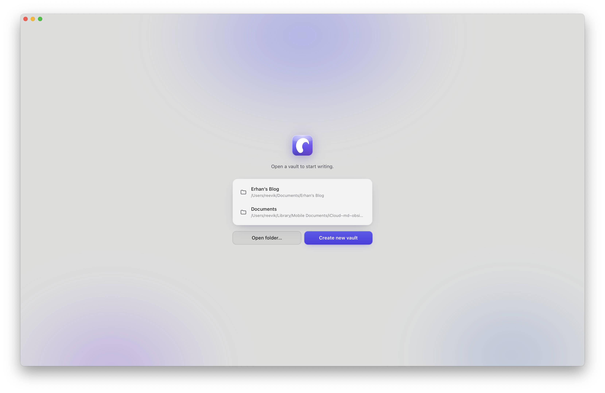
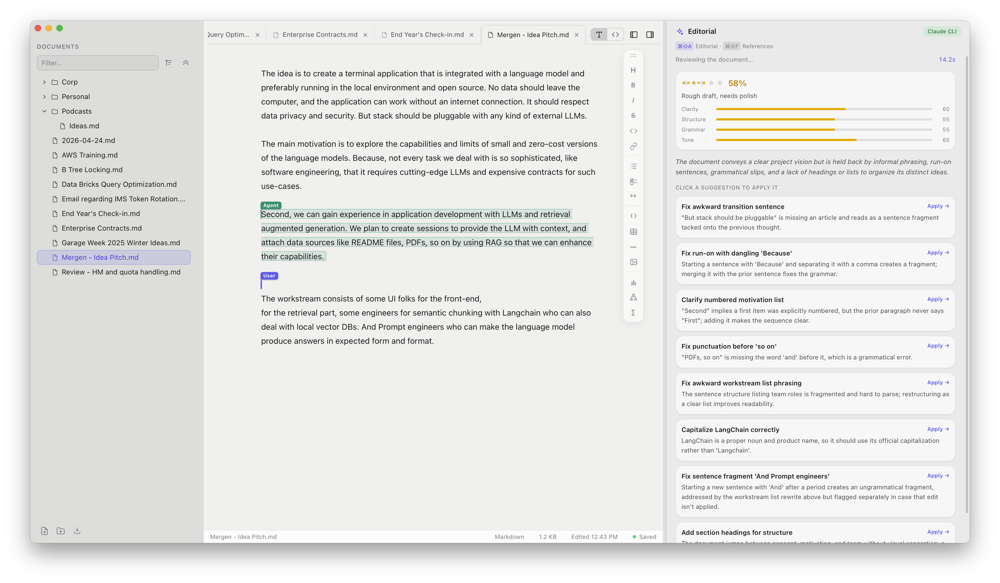

<p align="center">
  
</p>

<h1 align="center">Reevik Markdown Editor</h1>

<p align="center">
<b>A Markdown editor for macOS — Live preview embedded charts and diagrams, and a built-in Claude writing agent. (Claude Code required)</b>
</p>

<p align="center">
  
  
  
</p>

<table align="center">
  <tr>
    <td width="50%">
      
    </td>
    <td width="50%">
      
    </td>
  </tr>
</table>

---

## What makes it different

### An AI that works on the note, not beside it

Claude, through your local **`claude` CLI** (no API key needed) or your own
**Anthropic API key** — or **GitHub Copilot**.

- **Editorial chat** (`⌘⇧E`) — talk the note through with the agent. Ask it to add,
  change or remove something and it edits the note directly, as a single `⌘Z`.
- **Analyze** (`⌘⇧A`) — a quality score for clarity, structure, grammar and tone,
  and specific edits you apply with a click.
- **Find references** (`⌘⇧F`) — searches the web for papers, documentation and
  articles on your topic; every citation comes from a real search result.
- **Rephrase, restore diacritics, translate** (`⌘⇧R`, `⌘⇧D`, `⌘⇧T`) on any
  selection. Diacritic restoration is checked to change accents and nothing else.

### Vault housekeeping

- **Clean up** — rates every note for completeness in the background and marks the
  half-started ones that look safe to delete.
- **Reorganize** — proposes folders from what your notes are actually about. Review
  the structure before and after; every image and link keeps working, and one click
  undoes it.

### Rich Live Preview

Markdown renders as you write, showing its syntax only on the line you're editing.
[Vega-Lite](https://vega.github.io/vega-lite/) **charts**,
[Mermaid](https://mermaid.js.org) **diagrams** (UML, sequence, ER…) and KaTeX
**math** render in place — and **Export as PDF** (`⌘P`) keeps every one of them.

### Content Index

A ` ```content-index ` block renders an always-current contents list of every note
in its folder and below, read from the vault each time it draws so it never goes
stale. `|2` caps the depth; `include-headers=2` adds each note's headings, linked.

### Made for Obsidian vaults

- A vault is a plain folder of Markdown files — no database, no lock-in.
- **`[[Wikilinks]]`** with autocomplete, alongside ordinary relative links.
- **Coloured labels**, stored as frontmatter `tags` so Obsidian sees them too, with
  filtering by label.
- **Hidden notes** stay out of sight, and are never sent to the AI.

## Keyboard shortcuts

| | |
|---|---|
| `⌘N` / `⌘⇧N` | New note / new folder |
| `⌘W` / `⌘⇧W` | Close tab / close window |
| `⌘P` | Export as PDF |
| `⌘K` / `⌘⇧P` | Command palette |
| `⌘/` | Toggle Markdown source |
| `⌘⌥1` `⌘⌥2` `⌘⌥3` | Toggle sidebar / AI panel / toolbar |
| `⌘⇧E` | Editorial chat |
| `⌘⇧A` | Analyze document |
| `⌘⇧F` | Find references |
| `⌘⇧R` | Rephrase selection |
| `⌘⇧D` | Restore diacritics |
| `⌘⇧T` | Translate selection |
| `⌘⇧O` | Open vault |
| `⌘,` | Settings |
| `⌘B` `⌘I` `⌘E` `⌘⇧K` | Bold / italic / inline code / link |
| `⌘⇧X` `⌘⇧C` `⌘⇧L` `⌘⇧U` | Strikethrough / code block / list / checklist |

## Getting started

Download the latest artifact from releases and install it. Recent changes are in
the [changelog](CHANGELOG.md).

> The build is ad-hoc signed rather than notarised, so macOS warns on first launch — right-click → **Open**.

### Building from source

Requires [Rust](https://rustup.rs) and [Node.js](https://nodejs.org).

```sh
npm install
npm run tauri dev     # run in development
npm run tauri build   # produce a .app and .dmg
```

## Licence

Licensed under the Apache License, Version 2.0 — see [LICENSE](LICENSE) for the
full text, also available at <https://www.apache.org/licenses/LICENSE-2.0>.

Reevik bundles open-source packages under their own licences (mostly MIT,
Apache-2.0, BSD and ISC). The app lists every one, with its licence text, under
**Reevik ▸ About Reevik**; see also [NOTICE](NOTICE).

Unless required by applicable law or agreed to in writing, software distributed
under the Licence is distributed on an **"AS IS" BASIS, WITHOUT WARRANTIES OR
CONDITIONS OF ANY KIND**, either express or implied. See the Licence for the
specific language governing permissions and limitations under it.

© 2026 Erhan Bağdemir
